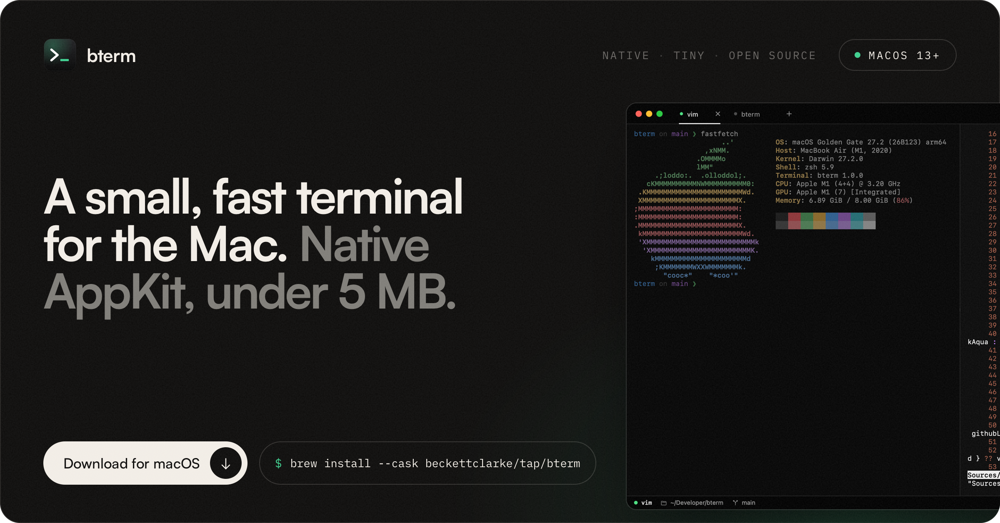
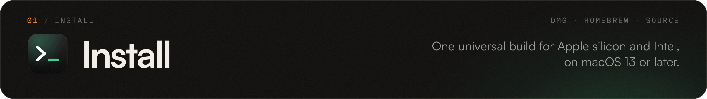
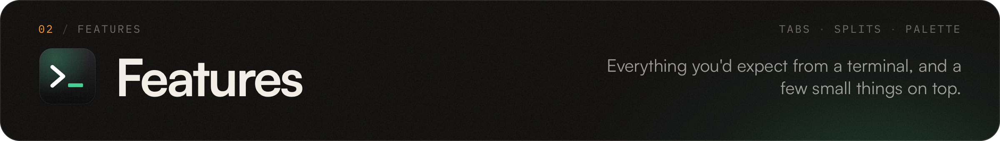
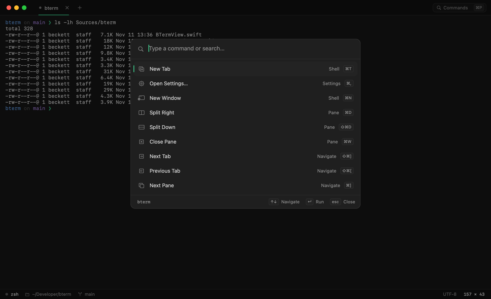
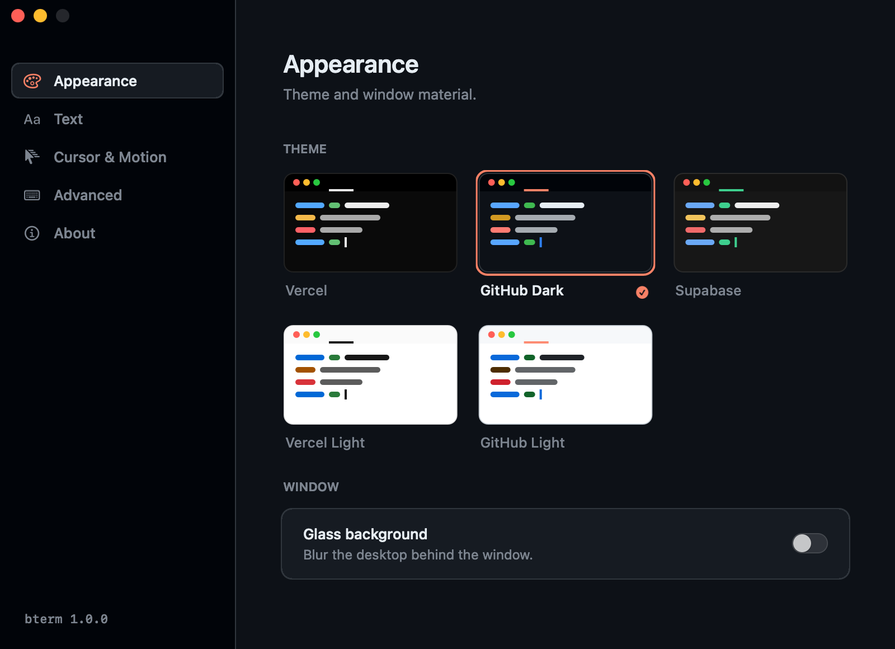
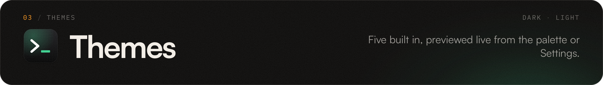
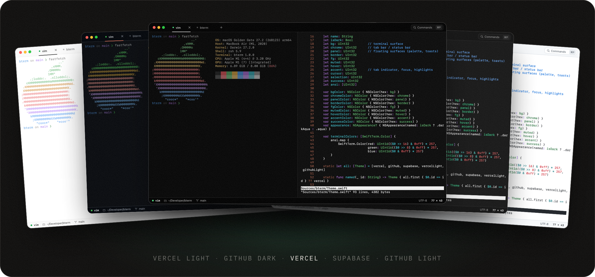
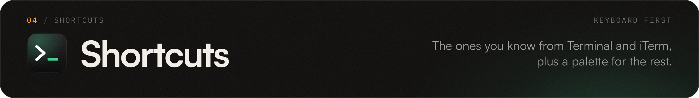
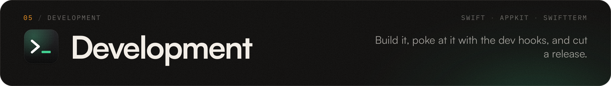
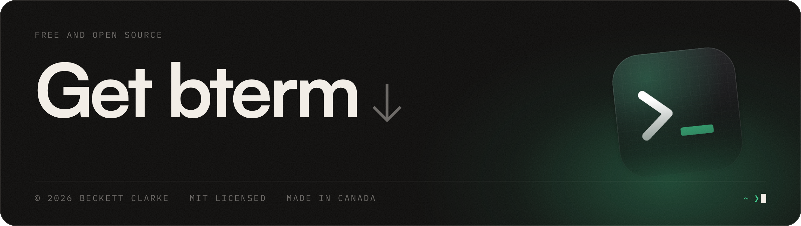

<a href="https://beckettclarke.github.io/bterm/">
  
</a>

<p align="center">
  <a href="https://github.com/beckettclarke/bterm/releases/latest"></a>
  <a href="https://github.com/beckettclarke/bterm/actions/workflows/ci.yml"></a>
  <a href="https://github.com/beckettclarke/homebrew-tap"></a>
  
  <a href="LICENSE"></a>
</p>

<p align="center">
  A small, fast, native terminal for macOS, with tabs, splits, a command palette and five themes.<br>
  AppKit and Core Animation. No Electron, no web view. <a href="https://beckettclarke.github.io/bterm/"><b>beckettclarke.github.io/bterm</b></a>
</p>

<br>



**Homebrew**

```bash
brew install --cask beckettclarke/tap/bterm
```

**Download.** Grab [`bterm.dmg`](https://github.com/beckettclarke/bterm/releases/latest/download/bterm.dmg) from the [latest release](https://github.com/beckettclarke/bterm/releases/latest), open it and drag bterm to Applications. It's one universal build for Apple silicon and Intel, on macOS 13 Ventura or later.

> [!NOTE]
> Releases aren't notarized by Apple yet. The first time you open a downloaded copy, macOS may say it can't check bterm for malicious software. Open **System Settings → Privacy & Security** and click **Open Anyway**, or run `xattr -dr com.apple.quarantine /Applications/bterm.app`. The Homebrew cask does this for you.

**From source.** You need Xcode 16 or newer.

```bash
git clone https://github.com/beckettclarke/bterm.git
cd bterm
./build.sh --install
```

<br>



<table>
  <tr>
    <td width="50%"></td>
    <td width="50%"></td>
  </tr>
  <tr>
    <td><b>Command palette.</b> <kbd>⌘P</kbd> for every command, theme and font. Themes preview live as you arrow through them.</td>
    <td><b>Settings that apply live.</b> Appearance, text, cursor and motion in one window (<kbd>⌘,</kbd>). Every open terminal updates as you change them.</td>
  </tr>
</table>

- **Full xterm emulation** through [SwiftTerm](https://github.com/migueldeicaza/SwiftTerm): 256 colour and truecolor, mouse reporting, the alternate screen for vim, htop and tmux, bracketed paste, OSC 8 hyperlinks, the Kitty keyboard and graphics protocols, Sixel, IME and wide characters.
- **Tabs and splits.** New tabs and windows open in the folder you're in. Split right or down as often as you like, move between panes with <kbd>⌥⌘</kbd> and the arrow keys, and drag tabs to reorder them.
- **A status bar that needs no setup.** The running process, the folder and the git branch come straight from the kernel (the pty's foreground process group, then `proc_pidinfo`). There's no shell integration to install.
- **Drag and drop.** Drop a file on a pane to paste its escaped path. Drop a folder on the Dock icon, or run `open -a bterm ~/some/folder`, to open a window there.
- **Any monospace font** you have installed, from SF Mono to Geist Mono, JetBrains Mono, Berkeley Mono and Fira Code.
- **An optional Metal renderer** for very heavy output. It's off by default because the cursor can't glide when Metal draws it.

**Motion.** Small animations, there to show you where things went.

| | |
| --- | --- |
| New lines | When output scrolls, each new line slides up from below. It switches itself off for floods like `cat`, builds and `yes`, and inside full-screen apps. |
| Cursor | Glides between cells and fades as it blinks. |
| Tabs | Grow in and collapse out. The underline slides between tabs, and switching slides the content in from the side you came from. |
| Panes | New splits rise in and unfocused panes dim. The bell flashes the pane's border. Dropping a file highlights the pane. |
| Status | A dot pulses while a command runs, with a ping when one starts. Background tabs with new output get a small blue dot. |
| Palette | Scales and fades in, and the highlight slides between rows. |
| Feedback | Toasts for font, theme and settings changes. A `cols × rows` readout sits in the middle of the window while you resize. |

Line slide-in and cursor glide each have a switch in **Settings → Cursor & Motion**.

<br>





| Dark | Light |
| --- | --- |
| Vercel (default), GitHub Dark, Supabase | Vercel Light, GitHub Light |

Pick one in **Settings → Appearance** or from the palette, where arrowing through the list previews each theme before you commit. Settings also has a glass background that blurs the desktop behind the window.

<br>



| Keys | Action | Keys | Action |
| --- | --- | --- | --- |
| <kbd>⌘P</kbd> | Command palette | <kbd>⌘,</kbd> | Settings |
| <kbd>⌘T</kbd> / <kbd>⌘N</kbd> | New tab / window, in the current folder | <kbd>⌘W</kbd> / <kbd>⇧⌘W</kbd> | Close pane / window |
| <kbd>⌘D</kbd> / <kbd>⇧⌘D</kbd> | Split right / down | <kbd>⌘]</kbd> <kbd>⌘[</kbd> | Next / previous pane |
| <kbd>⌥⌘</kbd> + arrows | Focus the pane in that direction | <kbd>⇧⌘]</kbd> <kbd>⇧⌘[</kbd> | Next / previous tab |
| <kbd>⌘1</kbd> … <kbd>⌘9</kbd> | Jump to a tab (<kbd>⌘9</kbd> is the last) | <kbd>⌘K</kbd> | Clear the buffer |
| <kbd>⌘F</kbd> <kbd>⌘G</kbd> <kbd>⇧⌘G</kbd> | Find, next, previous | <kbd>⌘+</kbd> <kbd>⌘−</kbd> <kbd>⌘0</kbd> | Font size |
| <kbd>⌘</kbd>-click | Open a link | <kbd>⌃⌘F</kbd> | Full screen |

<br>



```bash
./build.sh               # build/bterm.app for this Mac
./build.sh --universal   # Apple silicon and Intel in one binary
./build.sh --install     # also copy it to /Applications
./scripts/package.sh     # dist/bterm.dmg, dist/bterm.zip and SHA256SUMS
```

The first build clones [SwiftTerm v1.20.0](https://github.com/migueldeicaza/SwiftTerm/releases/tag/v1.20.0) into `Vendor/` and trims its manifest, so the build needs neither the Metal toolchain nor any other packages. The version comes from `BTERM_VERSION`, then the latest `v*` tag, then `Resources/Info.plist`.

```text
bterm/
├── Sources/bterm/
│   ├── main.swift                      app delegate, menus, dev hooks
│   ├── TerminalWindowController.swift  window, tabs, split tree, palette commands, overlays
│   ├── PaneView.swift                  one shell session, focus/bell/drop overlays, split view
│   ├── BTermView.swift                 SwiftTerm view subclass: smooth scroll, caret glide, drops
│   ├── TabBarView.swift                layer-built tabs, sliding indicator, drag to reorder
│   ├── StatusBarView.swift             process · folder · git branch · grid size
│   ├── CommandPalette.swift            fuzzy command menu
│   ├── SettingsWindow.swift            sidebar, theme cards, live font preview
│   ├── ToastView.swift                 toasts and the resize readout
│   ├── Theme.swift  Settings.swift     palettes and saved preferences
│   └── ProcessInfo+Shell.swift         libproc/sysctl lookups: foreground process, cwd, git HEAD
├── Resources/Info.plist
├── scripts/                            SwiftTerm fetch, icon, packaging, signing, cask, banners
├── site/                               the website, deployed to GitHub Pages
└── .github/
    ├── workflows/                      ci.yml, release.yml, pages.yml
    └── readme/                         these banners, and their HTML sources in src/
```

<details>
<summary><b>Dev hooks</b></summary>
<br>

Environment variables read at launch, for testing and screenshots. Run the binary directly, for example `BTERM_SLOWMO=10 build/bterm.app/Contents/MacOS/bterm`.

| Variable | Does |
| --- | --- |
| `BTERM_RUN='ls\n'` | Types into the first pane. |
| `BTERM_ACTIONS='splitRight:,newTab:'` | Sends menu actions one after another. Prefix one with `@` to send it through the responder chain, like `@showSettings:`. |
| `BTERM_SLOWMO=10` | Slows every animation down ten times. |
| `BTERM_SETTINGS_PAGE=1` | Opens Settings on that page. |
| `BTERM_SNAPSHOT=out.png` | Renders the key window to a PNG after `BTERM_SNAPSHOT_DELAY` seconds (default 4), then quits. |

Settings can be overridden for one launch as arguments, without touching your saved ones: `bterm -theme github-light -fontSize 14 -glass NO`.

</details>

<details>
<summary><b>Releasing</b></summary>
<br>

Push a version tag and [`release.yml`](.github/workflows/release.yml) does the rest:

```bash
git tag v1.1.0
git push origin v1.1.0
```

It builds the universal app, publishes a GitHub release with `bterm.dmg`, `bterm.zip` and `SHA256SUMS`, and updates the cask in [beckettclarke/homebrew-tap](https://github.com/beckettclarke/homebrew-tap). Tags with a suffix like `v1.1.0-beta.1` become pre-releases and leave the cask alone. Every push and pull request also builds and packages through [`ci.yml`](.github/workflows/ci.yml), with the result attached to the run.

| Secret | Needed for |
| --- | --- |
| `HOMEBREW_TAP_TOKEN` | Updating the cask. A fine-grained token with **Contents: read and write** on `beckettclarke/homebrew-tap`. |
| `MACOS_CERTIFICATE`, `MACOS_CERTIFICATE_PASSWORD` | Optional. A base64 Developer ID Application `.p12` and its password. |
| `MACOS_SIGNING_IDENTITY` | Optional. For example `Developer ID Application: Your Name (TEAMID)`. |
| `APPLE_ID`, `APPLE_TEAM_ID`, `APPLE_APP_PASSWORD` | Optional. Notarization, with an app-specific password. |

Without the Apple secrets, releases are ad-hoc signed and the cask clears the quarantine flag on install. With them, the app and disk image are signed, notarized and stapled, and the cask drops that step.

</details>

<details>
<summary><b>Screenshots and banners</b></summary>
<br>

The screenshots in `site/assets/shots` come from bterm itself through `BTERM_SNAPSHOT`, so they always match the current build. The banners in this README are HTML pages in [`.github/readme/src`](.github/readme/src), set in the same type and colours as the website, and rendered to PNG with:

```bash
swift scripts/render-banners.swift
```

</details>

<br>

<a href="https://github.com/beckettclarke/bterm/releases/latest/download/bterm.dmg">
  
</a>

<p align="center">
  <a href="https://beckettclarke.github.io/bterm/">Website</a> &nbsp;·&nbsp;
  <a href="https://github.com/beckettclarke/bterm/releases">Releases</a> &nbsp;·&nbsp;
  <a href="https://github.com/beckettclarke/bterm/issues">Issues</a> &nbsp;·&nbsp;
  <a href="https://beckettclarke.ca">beckettclarke.ca</a>
</p>

<p align="center"><sub>MIT licensed. Terminal emulation by <a href="https://github.com/migueldeicaza/SwiftTerm">SwiftTerm</a> (MIT), © Miguel de Icaza.<br>© 2026 Beckett Clarke · Made in 🇨🇦</sub></p>
