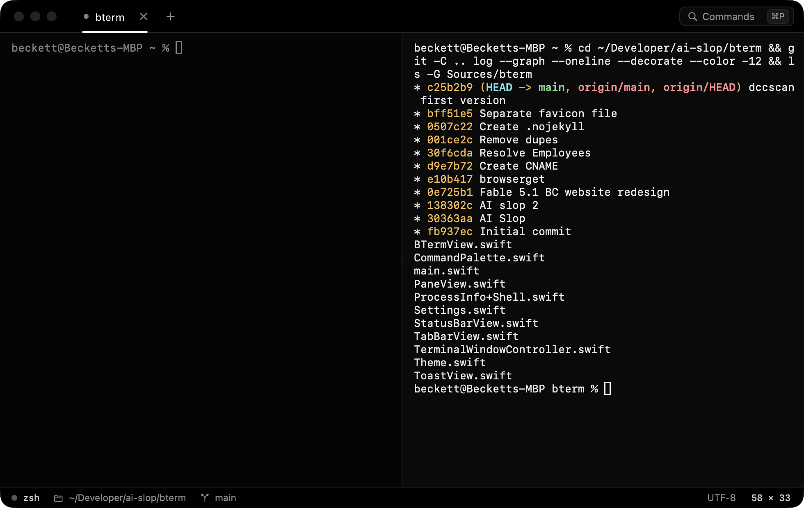

# bterm

A small, fast, native macOS terminal with Vercel / GitHub / Supabase-style chrome and motion.



- **~2.7 MB** app bundle (1.8 MB binary), ~45 MB RAM, ~0.1% CPU at idle
- Native AppKit + Core Animation. No Electron, no web view.
- Full xterm emulation via [SwiftTerm](https://github.com/migueldeicaza/SwiftTerm): 256-color and truecolor, mouse reporting, alternate screen (vim, htop, tmux), bracketed paste, OSC 8 hyperlinks, Kitty keyboard and graphics, Sixel, IME and wide characters
- 500k lines of output render in about 0.7 s

## Build

```bash
./build.sh            # → build/bterm.app
./build.sh --install  # also copies it to /Applications
```

You need Xcode 16 or newer (Swift 6). The first build clones SwiftTerm v1.20.0 into `Vendor/` and trims its manifest, so the build needs neither the Metal toolchain nor any extra packages.

## Motion

| What | How |
| --- | --- |
| New lines | When output scrolls, the new line slides up from below. This turns off automatically for floods like `cat`, builds or `yes`, and inside full-screen TUIs. |
| Cursor | Glides between cells and fades as it blinks. |
| Tabs | Grow in and collapse out. The underline indicator slides between tabs. Drag a tab to reorder it. |
| Tab switch | Directional slide plus crossfade. |
| Panes | New splits rise in. Unfocused panes dim. The bell flashes the pane border. Dropping a file highlights the pane and pastes its escaped path. |
| Status | A pulsing dot shows while a command runs, and a ping ring plays when one starts. Background tabs with new output show a blue dot. |
| Palette | Scales and fades in. The selection highlight slides between rows. Themes preview live as you arrow through them. |
| Feedback | Toasts for font, theme and settings changes. A centered `cols × rows` HUD appears while you resize. |

## Shortcuts

| | |
| --- | --- |
| ⌘P / ⇧⌘P | Command palette |
| ⌘, | Settings window |
| ⌘T / ⌘N | New tab / window (inherits the current directory) |
| ⌘D / ⇧⌘D | Split right / down |
| ⌘W / ⇧⌘W | Close pane / window |
| ⌘] ⌘[ | Next / previous pane |
| ⌥⌘ ←↑→↓ | Focus pane in a direction |
| ⇧⌘] ⇧⌘[ | Next / previous tab |
| ⌘1…⌘9 | Jump to a tab (⌘9 = last) |
| ⌘K | Clear buffer |
| ⌘F, ⌘G, ⇧⌘G | Find, next, previous |
| ⌘+ ⌘− ⌘0 | Font size |
| ⌘-click | Open link |

## Settings

Settings are in their own window (⌘,): Appearance, Text, Cursor & Motion, Advanced and About. Changes apply live to every terminal. The same options are also in the palette: theme (Vercel, GitHub Dark, Supabase, Vercel Light, GitHub Light), font (any installed font from SF Mono, Geist Mono, JetBrains Mono, Berkeley Mono, Fira Code, …), cursor shape, glass background, smooth scrolling, cursor glide, Option as Meta, and the GPU (Metal) renderer.

The GPU renderer lowers CPU use for very heavy output. Its trade-off is that the cursor doesn't glide, because Metal draws the cursor itself.

## Layout

```
Sources/bterm/
  main.swift                      app delegate, menus, dev hooks
  TerminalWindowController.swift  window, tabs, split tree, palette commands, overlays
  PaneView.swift                  one shell session + focus/bell/drop/scroll overlays; split view
  BTermView.swift                 SwiftTerm view subclass: smooth scroll, caret glide, drops
  TabBarView.swift                layer-built tabs, sliding indicator, drag-to-reorder
  StatusBarView.swift             process · directory · git branch · grid size
  CommandPalette.swift            fuzzy command menu
  SettingsWindow.swift            settings window: sidebar, theme cards, live font preview
  ToastView.swift                 toasts and resize HUD
  Theme.swift / Settings.swift    palettes and persisted preferences
  ProcessInfo+Shell.swift         libproc/sysctl lookups (foreground process, cwd, git HEAD)
```

Tab titles and the status bar come from the kernel: the pty's foreground process group, then `proc_pidinfo` for its cwd. No shell integration is needed.

Dev hooks: `BTERM_RUN='ls\n'` types into the first pane. `BTERM_ACTIONS='splitRight:,newTab:'` sends menu actions. `BTERM_SLOWMO=10` slows every animation. `BTERM_SETTINGS_PAGE=1` opens Settings on a given page.
